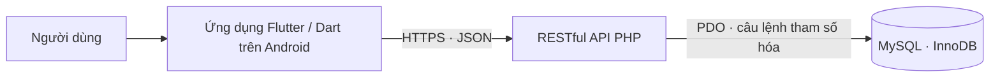
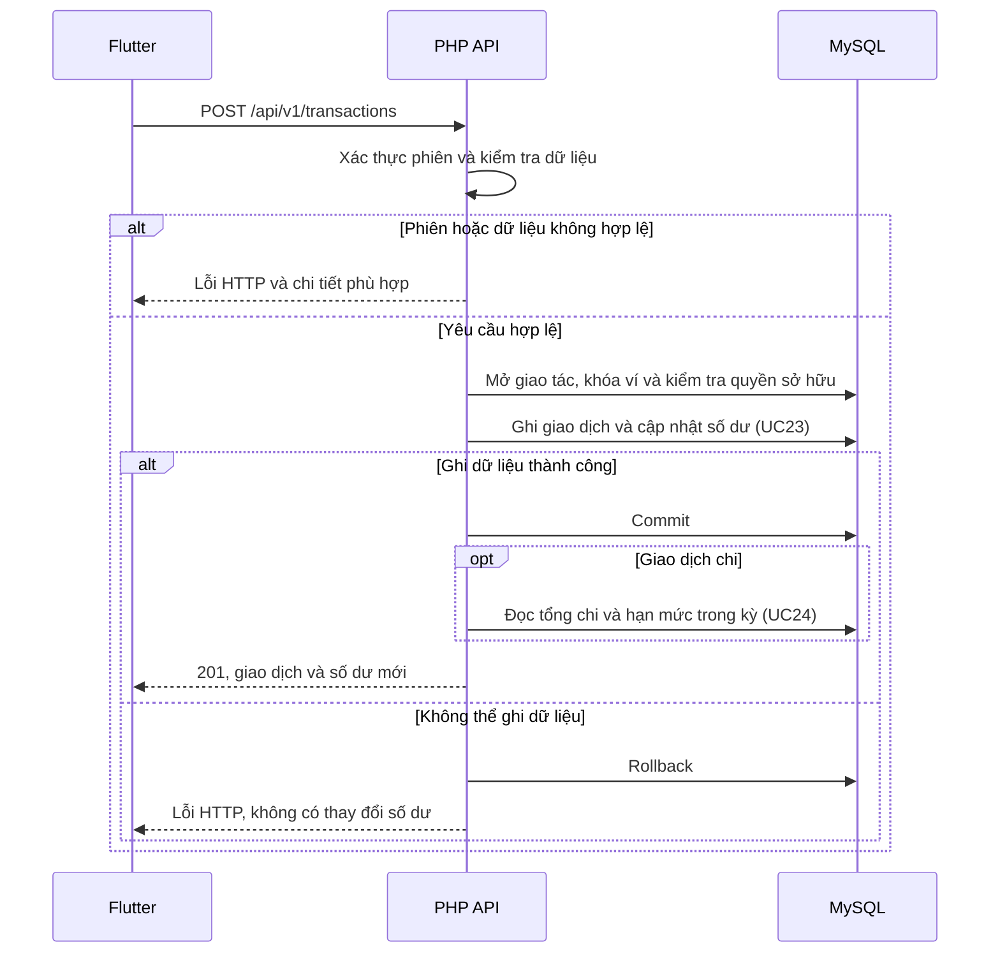

# Đề xuất kiến trúc hệ thống OurBudget

- **Trạng thái** Bản nháp để duyệt trước khi cài đặt back-end và RESTful API.
- **Ràng buộc đã chốt** Phát triển ứng dụng bằng Android Studio, viết API bằng PHP và lưu dữ liệu trong MySQL. Giai đoạn hiện tại hoàn thiện bản vẽ và đặc tả Markdown trước khi viết mã.

## Căn cứ thiết kế

- [Báo cáo đề tài](../../thesis/pdf/2.%20Báo%20cáo%20đề%20tài.pdf), mục 1.3.2 và 2.4, mô tả ứng dụng Flutter/Dart, RESTful API PHP và CSDL MySQL. Mục 3.1–3.3 là căn cứ về phạm vi chức năng, luồng hoạt động và thiết kế dữ liệu.
- [Đặc tả use-case](use-case-diagram.md) mô tả UC1–UC24. Trong đó, UC23 cập nhật số dư và UC24 kiểm tra hạn mức là xử lý nội bộ của API.

## Các thành phần

Đề xuất một API PHP triển khai chung, chia theo phân hệ bên trong. Cách tổ chức này cho phép sửa giao dịch và số dư trong cùng một giao tác MySQL.

| Thành phần | Trách nhiệm |
| --- | --- |
| Flutter/Dart, phát triển trong Android Studio | Hiển thị, kiểm tra biểu mẫu, quản lý trạng thái màn hình và gọi API. Đề xuất dùng Provider theo luồng trong báo cáo. Cập nhật số dư hiển thị từ phản hồi thành công của máy chủ. |
| PHP RESTful API | Bộ định tuyến và controller xử lý HTTP/JSON. Lớp xác thực xác định người dùng. Service xử lý nghiệp vụ và ranh giới giao tác. Lớp truy cập dữ liệu dùng PDO. |
| MySQL | Nguồn dữ liệu chính, dùng InnoDB và UTF-8 (`utf8mb4`). Chứa khóa ngoại, ràng buộc và chỉ mục phục vụ lịch sử, ngân sách, báo cáo. Chỉ API kết nối đến MySQL. |

## Phân hệ và ranh giới API

Các đường dẫn dưới đây là đề xuất để duyệt. Tài liệu hợp đồng API sẽ mô tả phương thức, trường dữ liệu, phân trang và lỗi của từng thao tác.

| Phân hệ | Use-case | Tài nguyên API đề xuất |
| --- | --- | --- |
| Tài khoản | UC1–UC5 | `/api/v1/auth/…`, `/api/v1/me` |
| Nguồn tiền | UC6–UC10 | `/api/v1/wallets`, `/api/v1/transfers` |
| Danh mục thu/chi | UC11–UC14 | `/api/v1/categories` |
| Giao dịch | UC15–UC19, UC23 | `/api/v1/transactions`. UC17 dùng bộ lọc trên danh sách giao dịch. |
| Ngân sách và báo cáo | UC20–UC22, UC24 | `/api/v1/budgets`, `/api/v1/reports`. Trạng thái ngân sách được tính từ giao dịch chi trong kỳ. |

Báo cáo minh họa UC15 bằng `POST /api/transactions/create` và phản hồi `200`. Đề xuất dùng `POST /api/v1/transactions` và `201 Created`. Hai quy ước này cần được duyệt trước khi đặc tả hợp đồng. Đề xuất thống nhất `401` cho phiên không hợp lệ, `404` cho tài nguyên người dùng không thể truy cập, `409` cho xung đột nghiệp vụ và `422` cho trường dữ liệu không hợp lệ.

## Luồng ghi giao dịch

- Kiểm tra danh mục, loại giao dịch và quyền sở hữu mọi tài nguyên liên quan ở máy chủ. Dùng mã người dùng từ phiên xác thực.
- Khi sửa hoặc xóa giao dịch, hoàn tác ảnh hưởng cũ và áp dụng ảnh hưởng mới trong một giao tác. Khi chuyển tiền, khóa hai ví theo cùng thứ tự và ghi đủ hai phía trong một giao tác. Chuyển nội bộ được loại khỏi tổng thu/chi và tổng chi dùng cho ngân sách.
- Sau khi ghi thành công, trả giao dịch và số dư đã lưu. Nếu truy vấn trạng thái ngân sách thất bại sau commit, vẫn xác nhận giao dịch đã lưu và cho phép tải lại trạng thái ngân sách. Hợp đồng API cần quy định khóa chống ghi trùng cho tạo giao dịch/chuyển tiền và cách phản hồi khi Flutter gửi lại yêu cầu sau mất kết nối.

## Mô hình dữ liệu và bảo mật

- Lấy sáu bảng trong báo cáo làm cơ sở gồm `users`, `wallet_categories`, `wallets`, `expense_categories`, `transactions` và `budgets`. Bảo toàn ý nghĩa số dư đầu kỳ, số dư hiện tại và số tiền có dấu theo báo cáo. Dùng `DECIMAL` trong MySQL và đề xuất gửi tiền dưới dạng chuỗi thập phân ở API để giữ độ chính xác.
- [PDM hiện tại](../dgr/database-dgr/PDM_OurBudget.pdm) có đích **SAP SQL Anywhere 17**. Trước khi sinh SQL, cần duyệt ERD và PDM đích MySQL, đối chiếu kiểu dữ liệu, khóa, chỉ mục và quan hệ. Đặc tả dữ liệu cần làm rõ các trường hợp chuyển tiền, ví mặc định, danh mục thu/chi, phiên đăng nhập và khôi phục mật khẩu.
- Đề xuất dùng token phiên có hạn và có thể thu hồi khi đăng xuất. Lưu mật khẩu bằng hàm băm mật khẩu của PHP. Bảo vệ đăng nhập và khôi phục mật khẩu bằng giới hạn tần suất. Log kỹ thuật dùng mã yêu cầu và tránh ghi mật khẩu, token hay nội dung giao dịch.
- Báo cáo (mục 3.2.2) quy định ba mức sử dụng ngân sách: dưới 80%, từ 80% đến dưới 100%, và từ 100% trở lên. Tỷ lệ lấy tổng độ lớn các khoản chi chia cho hạn mức dương. Đề xuất giữ các ngưỡng này cho cả ngân sách theo danh mục và ngân sách tổng.
- Báo cáo và ngân sách dùng cùng quy tắc về ngày phát sinh giao dịch, múi giờ và khoảng thời gian. Cần chốt cách xác định biên kỳ tuần/tháng và cách tính lại các kỳ liên quan khi sửa, xóa hoặc chuyển ngày giao dịch.

## Duyệt thiết kế trước khi triển khai

1. Duyệt kiến trúc chung này và phạm vi UC1–UC24. Làm rõ ảnh hóa đơn và các tính năng mở rộng được nhắc trong báo cáo.
2. Duyệt mô hình dữ liệu MySQL và các quy tắc số dư, chuyển tiền, lưu trữ lịch sử và xóa dữ liệu. Hoàn thiện ERD, từ điển dữ liệu và ràng buộc bằng Markdown.
3. Duyệt hợp đồng RESTful API theo UC, cơ chế phiên và khôi phục mật khẩu, quy tắc lỗi và xử lý yêu cầu gửi lại. Chốt framework PHP và môi trường chạy API/MySQL.
4. Duyệt sơ đồ triển khai và kịch bản kiểm thử. Các ca bắt buộc gồm cách ly dữ liệu hai tài khoản, rollback khi ghi lỗi, chống ghi trùng, và số liệu ngân sách/báo cáo khớp sau khi sửa hoặc xóa giao dịch.

Sau mỗi quyết định được duyệt, tạo một tệp Markdown riêng trong `src/docs/` ghi phạm vi, phương án đã chốt, sơ đồ hoặc hợp đồng liên quan và tiêu chí nghiệm thu để agent triển khai. Agent bắt đầu viết mã sau khi bộ tài liệu kiến trúc được duyệt.
