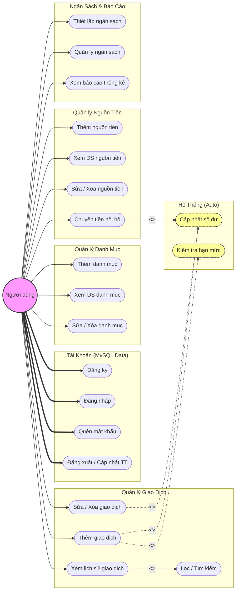

# TỔNG QUAN SƠ ĐỒ USE-CASE HỆ THỐNG QUẢN LÝ CHI TIÊU CÁ NHÂN

## 1. Danh sách cấu trúc văn bản chi tiết (Đặc tả Use-case)

**Tác nhân (Actor) duy nhất:** Người dùng cá nhân (User) - Là người trực tiếp sử dụng ứng dụng di động để quản lý tài chính, thực hiện các thao tác trên giao diện Flutter và dữ liệu được đồng bộ hóa xuống CSDL MySQL thông qua PHP API.

Hệ thống được phân rã chi tiết thành 5 phân hệ chính với các Use-case (UC) tương ứng như sau:

### Phân hệ 1: Quản lý tài khoản (Account Management)
*   **UC1 - Đăng ký tài khoản:** Cho phép người dùng tạo tài khoản mới. Thông tin được mã hóa và lưu trữ an toàn vào MySQL.
*   **UC2 - Đăng nhập:** Người dùng xác thực thông tin để truy cập vào hệ thống. (Đây là điều kiện tiên quyết cho hầu hết các chức năng bên dưới).
*   **UC3 - Quên mật khẩu:** Cho phép người dùng lấy lại quyền truy cập khi mất mật khẩu (thông qua email/OTP).
*   **UC4 - Đăng xuất:** Kết thúc phiên làm việc an toàn.
*   **UC5 - Cập nhật thông tin cá nhân:** Thay đổi tên, avatar hoặc mật khẩu hiện tại.

### Phân hệ 2: Quản lý nguồn tiền / Ví (Wallet Management)
*   **UC6 - Thêm nguồn tiền:** Khởi tạo một ví mới (Ví tiền mặt, tài khoản ngân hàng, ví điện tử) kèm số dư ban đầu.
*   **UC7 - Xem danh sách nguồn tiền:** Hiển thị toàn bộ các ví đang có và tổng số dư tương ứng.
*   **UC8 - Cập nhật thông tin nguồn tiền:** Chỉnh sửa tên ví, biểu tượng hoặc số dư ban đầu.
*   **UC9 - Xóa nguồn tiền:** Xóa ví (có cảnh báo dữ liệu giao dịch liên quan).
*   **UC10 - Chuyển tiền nội bộ:** Chuyển đổi dòng tiền từ ví này sang ví khác.
    *   *Mối quan hệ:* Bao hàm (`<<include>>`) **UC23 - Cập nhật số dư nguồn tiền** (Trừ tiền ví nguồn, cộng tiền ví đích).

### Phân hệ 3: Quản lý danh mục Thu/Chi (Category Management)
*   **UC11 - Thêm danh mục:** Tạo danh mục thu/chi mới (ví dụ: Ăn sáng, Tiền điện, Đổ xăng) với biểu tượng và màu sắc riêng.
*   **UC12 - Xem danh sách danh mục:** Liệt kê các danh mục được chia theo tab Thu nhập và Chi tiêu.
*   **UC13 - Cập nhật danh mục:** Sửa đổi tên hoặc biểu tượng của danh mục đã tạo.
*   **UC14 - Xóa danh mục:** Gỡ bỏ danh mục khỏi hệ thống.

### Phân hệ 4: Quản lý giao dịch (Transaction Management)
*   **UC15 - Thêm giao dịch:** Ghi chép một khoản thu hoặc chi mới.
    *   *Mối quan hệ 1:* Bao hàm (`<<include>>`) **UC23 - Cập nhật số dư nguồn tiền**.
    *   *Mối quan hệ 2:* Bao hàm (`<<include>>`) **UC24 - Kiểm tra hạn mức ngân sách** (Áp dụng khi loại giao dịch là "Chi").
*   **UC16 - Xem lịch sử giao dịch:** Hiển thị nhật ký thu chi.
    *   *Mối quan hệ:* Mở rộng (`<<extend>>`) thành **UC17 - Lọc và tìm kiếm giao dịch** (Lọc theo ngày, tháng, ví, danh mục).
*   **UC18 - Cập nhật giao dịch:** Chỉnh sửa số tiền, ngày tháng hoặc danh mục của giao dịch cũ.
    *   *Mối quan hệ:* Bao hàm (`<<include>>`) **UC23 - Cập nhật số dư nguồn tiền** (Tính toán lại số dư dựa trên chênh lệch).
*   **UC19 - Xóa giao dịch:** Xóa một giao dịch bị nhập sai.
    *   *Mối quan hệ:* Bao hàm (`<<include>>`) **UC23 - Cập nhật số dư nguồn tiền** (Hoàn trả lại số dư trước khi giao dịch diễn ra).

### Phân hệ 5: Hoạch định ngân sách & Báo cáo (Budget & Report)
*   **UC20 - Thiết lập ngân sách:** Tạo hạn mức chi tiêu cho một danh mục hoặc tổng chi tiêu trong khoảng thời gian nhất định (tuần/tháng).
*   **UC21 - Quản lý ngân sách:** Xem danh sách, cập nhật hoặc xóa hạn mức ngân sách đã thiết lập.
*   **UC22 - Xem báo cáo thống kê:** Trực quan hóa dữ liệu bằng biểu đồ (biểu đồ tròn phân bổ danh mục, biểu đồ đường biến động dòng tiền).
*   **UC23 - Cập nhật số dư nguồn tiền (Use-case hệ thống/ẩn):** Tự động tính toán lại số dư của ví khi có giao dịch thay đổi.
*   **UC24 - Kiểm tra hạn mức ngân sách (Use-case hệ thống/ẩn):** Tự động so sánh số tiền chi với ngân sách, kích hoạt cảnh báo nếu vượt ngưỡng.

---

## 2. Mã Code Mermaid (Render Sơ đồ)

*Ghi chú: Bạn có thể sao chép đoạn code bên dưới, dán vào một công cụ hỗ trợ Markdown có render Mermaid (như Obsidian, Notion) hoặc trang web **mermaid.live** để xuất ra hình ảnh sắc nét đưa vào báo cáo.*

